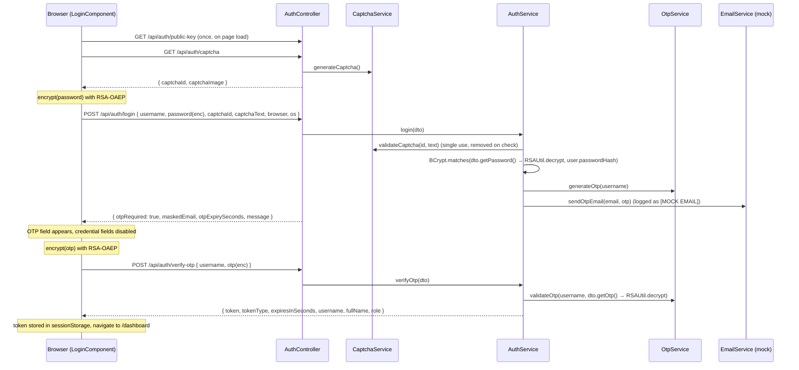

# Project Context: login-app

This is the single source of context for anyone, human or AI agent, picking up work on this repository.
Read it fully before changing code. It describes the state of `main` unless a section says otherwise.

---

## 1. Purpose and background

- This repository is a **working recreation of the login module of an application the owner maintains at their office**.
  The office source code is not available here, so the module was rebuilt from a detailed description, with the goal
  that changes developed here can be **copied into the office codebase with minimal adaptation**.
- Because of that, **fidelity to the office code matters more than idiomatic redesign.** In particular:
  - **Do not change the request DTOs** (`LoginRequestDto`, `OtpVerifyRequestDto`) or their JSON shape unless the owner asks.
  - **Do not change the login flow** (captcha → credentials → OTP → JWT) or the order of checks unless the owner asks.
  - The office code **decrypts inside the DTO getters** (`getPassword()`, `getOtp()`). That pattern is kept deliberately.
- Work so far:
  1. Recreated the original module (Angular + Spring Boot, AES-encrypted password and OTP).
  2. **Security incident at the office:** a Burp Suite scan found the AES key in the deployed JS bundle. The encryption
     was replaced with **RSA-OAEP** (merged to `main`, PR #1).
  3. **Replay protection with a nonce** is implemented on `feature/replay-protection`, **pushed but not merged** (see §13).

---

## 2. Tech stack

| Layer | Technology |
|---|---|
| Frontend | Angular 17.3 (standalone components, no NgModules), TypeScript 5.4, RxJS 7.8, SCSS, Web Crypto API |
| Backend | Spring Boot 3.2.12, Java 17, Maven, Spring Web, Spring Security, Spring Data JPA, Bean Validation |
| Auth | BCrypt (Spring Security), JWT via jjwt 0.12.6 (HS384) |
| Database | H2 in-memory (stand-in for the office database) |
| Other | Lombok, Java AWT (captcha image), PKCS12 keystore (RSA key) |

The office project uses the same major versions: Angular 17, Spring Boot 3.x with `jakarta.*` imports.

---

## 3. Repository layout

```
login-app/
├── AGENTS.md                         Pointer to this document for AI agents
├── README.md                         Short overview and run instructions
├── docs/PROJECT_CONTEXT.md           This document
├── backend/
│   ├── pom.xml
│   ├── scripts/generate-keystore.sh  Creates the PKCS12 keystore holding the RSA key pair
│   ├── keys/                         Local keystore + password file (git-ignored, never commit)
│   └── src/main/java/com/example/loginapp/
│       ├── LoginAppApplication.java
│       ├── config/
│       │   ├── SecurityConfig.java       Filter chain, CORS, BCrypt bean, public URLs
│       │   ├── RsaKeyStoreConfig.java    Loads RSA key pair from PKCS12 at startup into RSAUtil
│       │   └── DataInitializer.java      Seeds demo users
│       ├── controller/
│       │   ├── AuthController.java       /api/auth/* (captcha, public-key, login, verify-otp)
│       │   └── UserController.java       /api/user/me (JWT-protected)
│       ├── dto/                          Request/response DTOs (LoginRequestDto, OtpVerifyRequestDto, ...)
│       ├── entity/User.java              JPA entity, table "users"
│       ├── exception/                    AuthException hierarchy + GlobalExceptionHandler
│       ├── repository/UserRepository.java
│       ├── security/
│       │   ├── JwtService.java           Issues/parses JWTs
│       │   └── JwtAuthFilter.java        Reads "Authorization: Bearer", sets SecurityContext
│       ├── service/
│       │   ├── AuthService.java          Login step 1 and step 2 orchestration
│       │   ├── CaptchaService.java       Captcha generation/validation (in-memory)
│       │   ├── OtpService.java           OTP generation/validation (in-memory)
│       │   └── EmailService.java         MOCK: logs the OTP instead of emailing it
│       └── util/RSAUtil.java             RSA-OAEP decryption (static, used from DTO getters)
│   └── src/test/java/com/example/loginapp/AuthFlowIntegrationTest.java
└── frontend/
    ├── proxy.conf.json                   Dev proxy: /api → http://localhost:8080
    └── src/
        ├── environments/environment.ts  apiUrl only (no keys!)
        └── app/
            ├── app.config.ts             Router + HttpClient with authInterceptor
            ├── app.routes.ts             /login, /forgot-password, /dashboard (guarded)
            ├── core/
            │   ├── models/auth.models.ts         Request/response interfaces
            │   ├── services/auth.service.ts      HTTP calls, JWT in sessionStorage
            │   ├── services/encryption.service.ts RSA-OAEP via Web Crypto
            │   ├── interceptors/auth.interceptor.ts Adds Bearer token; 401 → logout
            │   └── guards/auth.guard.ts          Blocks /dashboard without token
            └── pages/
                ├── login/                Login + OTP UI (the main screen)
                ├── dashboard/            Post-login page, calls /api/user/me
                └── forgot-password/      PLACEHOLDER only (not implemented)
```

---

## 4. Login flow

The flow is **sequential with separate endpoints**. The order of checks is part of the office behaviour: **captcha first, then credentials**.



UI behaviour (`login.component.ts`):
- On any login failure, the captcha is **always reloaded** (captchas are single-use) and the error message is shown.
- After credentials succeed, the form is disabled, the OTP form appears, and a countdown runs for `otpExpirySeconds`.
  When it reaches 0 the user is sent back to the credentials step.
- If `verify-otp` returns `errorCode: OTP_EXPIRED` (expired, missing, or attempts exhausted), the UI resets to step 1.
  For `INVALID_OTP` it clears the OTP field and lets the user retry.
- "Back to login" resets to step 1 and loads a new captcha.

---

## 5. API reference

All endpoints are under `/api`. `/api/auth/**` is public; everything else needs `Authorization: Bearer <jwt>`.

| Method | Path | Request | Success response |
|---|---|---|---|
| GET | `/api/auth/public-key` | – | `{ publicKey }`: RSA public key, X.509 SPKI, Base64 |
| GET | `/api/auth/captcha` | – | `{ captchaId, captchaImage }`: image is `data:image/png;base64,...` |
| POST | `/api/auth/login` | `{ username, password, captchaId, captchaText, browser?, os? }`; `password` is RSA-encrypted Base64 | `{ otpRequired, maskedEmail, otpExpirySeconds, message }` |
| POST | `/api/auth/verify-otp` | `{ username, otp }`; `otp` is RSA-encrypted Base64 | `{ token, tokenType: "Bearer", expiresInSeconds, username, fullName, role }` |
| GET | `/api/user/me` | Bearer token | `{ username, fullName, email, role, lastLoginAt }` |

Errors always use `ErrorResponseDto`: `{ timestamp, status, errorCode, message }`.

| errorCode | HTTP | Raised when |
|---|---|---|
| `VALIDATION_FAILED` | 400 | A `@NotBlank` field is missing |
| `BAD_REQUEST` | 400 | Malformed JSON |
| `INVALID_CAPTCHA` | 400 | Wrong captcha text, or captcha unknown, expired or already used |
| `DECRYPTION_FAILED` | 400 | Password/OTP is not valid RSA-OAEP ciphertext for the current key |
| `INVALID_CREDENTIALS` | 401 | Unknown user, inactive user or wrong password (one message for all, to avoid user enumeration) |
| `INVALID_OTP` | 401 | Wrong OTP, attempts remain ("N attempt(s) left") |
| `OTP_EXPIRED` | 401 | OTP missing, expired or max attempts reached; user must log in again |
| `INTERNAL_ERROR` | 500 | Any unhandled exception (logged server-side) |
| (no body) | 401 | Protected endpoint without a valid JWT |

---

## 6. Backend details

### DTO decrypt-in-getter pattern (mirrors the office code)
```java
// LoginRequestDto
public String getPassword() { return RSAUtil.decrypt(password); }
// OtpVerifyRequestDto
public String getOtp()      { return RSAUtil.decrypt(otp); }
```
- The raw field holds ciphertext; the getter returns plaintext. Lombok generates the other getters/setters.
- `@ToString(exclude = "password" / "otp")` keeps secrets out of logs.
- Bean Validation annotations sit on the **fields**, so validation never calls the getter (no decryption during validation).
- Jackson deserializes via setters, so the getter is not called during deserialization.
- Because `RSAUtil` is used from a DTO, it is a **static utility** whose keys are injected once at startup by `RsaKeyStoreConfig`.

### Services
- **AuthService**: `login()` = captcha → user lookup (`active` only) → BCrypt match → generate OTP → mock email → masked email response.
  `verifyOtp()` = user lookup → OTP check → update `lastLoginAt` → issue JWT.
- **CaptchaService**: 6 characters from an alphabet without look-alikes (no 0/O/1/l/I), rendered with AWT noise. Stored in a
  `ConcurrentHashMap` keyed by UUID with a 120 s expiry. **Single use**: removed on validation whatever the result.
  **Case-sensitive** comparison; input is trimmed.
- **OtpService**: 6-digit `SecureRandom` OTP, one active OTP per username (a new login replaces it), 300 s expiry, 3 attempts.
  Removed on success, expiry or exhausted attempts.
- **EmailService**: **mock**; logs `[MOCK EMAIL] To: ... | Your login OTP is NNNNNN`. Replace with the office mail service.
- **JwtService**: HMAC key from `app.jwt.secret` (Base64), subject = username, claim `role`, expiry `app.jwt.expiry-minutes`.

### Security config
- CSRF disabled (stateless JWT API), sessions `STATELESS`.
- Public: `/api/auth/**`, `/h2-console/**`, `/error`. Everything else authenticated.
- Unauthenticated requests get a bare `401` (`HttpStatusEntryPoint`).
- CORS allows `app.cors.allowed-origins` (default `http://localhost:4200`).
- `JwtAuthFilter` sets authority `ROLE_<role>`; invalid tokens are ignored, so the request is treated as anonymous.

### Data
- Table `users`: `id, username (unique), password_hash (BCrypt), full_name, email, role, active, last_login_at`.
- Demo users seeded at startup: **`admin / Admin@123`** (ADMIN, admin@example.com) and **`john / John@123`** (USER, john.doe@example.com).

---

## 7. Frontend details

- **EncryptionService**: `loadPublicKey()` fetches `/api/auth/public-key` once, imports it as an RSA-OAEP/SHA-256 `CryptoKey`
  and caches it (`shareReplay(1)`, so a failed fetch is retried on the next call). `encrypt(text)` returns an `Observable<string>`
  of Base64 ciphertext. `clearPublicKey()` drops the cache; it is called after a `DECRYPTION_FAILED` response in case the key was rotated.
- **LoginComponent**: reactive forms. Because Web Crypto is async, each submit is `encrypt(...).pipe(switchMap(enc => api(...)))`.
  Password field has `maxLength(128)` (see §8). Non-HTTP errors (Web Crypto failures) show a generic "Unable to encrypt" message.
- **AuthService**: `getPublicKey`, `getCaptcha`, `login`, `verifyOtp` (stores `auth_token` and `auth_user` in `sessionStorage`),
  `getProfile`, `isLoggedIn`, `logout`.
- **authInterceptor**: adds `Bearer` to non-`/auth/` calls; on a 401 from a non-auth call it logs out and routes to `/login`.
- **authGuard**: protects `/dashboard`.
- **Dev proxy**: `npm start` serves on `:4200` and proxies `/api` to `:8080` (`proxy.conf.json`).

---

## 8. Encryption design

### History
1. **Original (office):** AES-128/CBC/PKCS5 with a **fixed key and IV in both the frontend (CryptoJS) and backend**.
2. **Incident:** Burp Suite found the key in the deployed `.js` bundle, so anyone could decrypt captured passwords and OTPs.
3. **Now (`main`):** **RSA-OAEP, 2048-bit, SHA-256 (MGF1 SHA-256)**. The browser only has the public key, which cannot decrypt.

### Rules and pitfalls
- **Java must use an explicit `OAEPParameterSpec("SHA-256", "MGF1", MGF1ParameterSpec.SHA256, PSpecified.DEFAULT)`
  with `RSA/ECB/OAEPPadding`.** The shorthand `RSA/ECB/OAEPWithSHA-256AndMGF1Padding` uses **SHA-1 for MGF1** and
  fails against Web Crypto with `BadPaddingException`. A test (`sha1MgfCiphertextIsRejected`) guards this.
- OAEP is randomized: the same password gives different ciphertext each time (unlike the old fixed-IV AES).
- **Size limit:** RSA-2048 + OAEP/SHA-256 encrypts at most **190 bytes**, so passwords are capped at 128 characters in the UI.
- **Web Crypto needs a secure context** (HTTPS or `localhost`). The office app is served over HTTPS with HSTS.
- Payload shapes did not change: `password` and `otp` are still Base64 strings.
- This is **defence in depth on top of TLS**, not a replacement for it. It keeps plaintext out of anything that terminates
  TLS before the app (proxies, WAFs, request-body logs) and fixes the leaked-key incident. It does not by itself stop replay (see §13).

---

## 9. Keystore and secrets

- The RSA key pair lives in a **PKCS12 keystore** (the office keeps secrets in PKCS12 stores).
- Loaded once at startup by `RsaKeyStoreConfig`, which calls `RSAUtil.init(privateKey, publicKey)`.
- **Startup fails** if the keystore is missing, the password is unset or wrong, or the alias has no private key. There is
  deliberately no fallback to a generated key.

| Property | Env var | Default |
|---|---|---|
| `app.rsa.keystore.path` | `LOGIN_KEYSTORE_PATH` | `keys/login-keys.p12` (relative to the working directory, i.e. `backend/`) |
| `app.rsa.keystore.password` | `LOGIN_KEYSTORE_PASSWORD` | **none (required)** |
| `app.rsa.keystore.alias` | `LOGIN_KEYSTORE_ALIAS` | `login-rsa` |

Create one with `backend/scripts/generate-keystore.sh [path]` (uses `keytool`, RSA-2048, SHA256withRSA, 10-year self-signed cert).
If `LOGIN_KEYSTORE_PASSWORD` is not set, the script generates a random one into `<keystore>.password` (mode 600).
It refuses to overwrite an existing keystore.

**This repository is public.** Never commit:
- keystores (`*.p12`, `*.jks`), `*.password` files, `backend/keys/` (all git-ignored);
- real office keys, secrets, hostnames or code;
- personal emails. Commits use the GitHub no-reply address `codingnerd1007@users.noreply.github.com` (set in this repo's local git config).

Values in the repo that are **dev-only placeholders**: `app.jwt.secret` in `application.properties` and the demo user passwords.
Production must override the JWT secret (see §14).

---

## 10. Configuration reference (`backend/src/main/resources/application.properties`)

| Key | Default | Meaning |
|---|---|---|
| `server.port` | 8080 | Backend port |
| `spring.datasource.*` | H2 `jdbc:h2:mem:loginapp` | In-memory DB, recreated every start (`ddl-auto=create-drop`) |
| `spring.h2.console.enabled` | true | H2 console at `/h2-console` (JDBC URL above, user `sa`, empty password) |
| `app.cors.allowed-origins` | `http://localhost:4200` | Comma-separated allowed origins |
| `app.rsa.keystore.*` | see §9 | RSA keystore |
| `app.captcha.length` | 6 | Captcha characters |
| `app.captcha.expiry-seconds` | 120 | Captcha lifetime |
| `app.otp.length` | 6 | OTP digits |
| `app.otp.expiry-seconds` | 300 | OTP lifetime (also drives the UI countdown) |
| `app.otp.max-attempts` | 3 | Wrong OTPs before `OTP_EXPIRED` |
| `app.jwt.secret` | dev placeholder | Base64 HMAC key, at least 256 bits; **override in production** |
| `app.jwt.expiry-minutes` | 30 | JWT lifetime |

---

## 11. Running and testing

Prerequisites: Java 17, Maven 3.6+, Node 18+ (Node 24 is used here), npm.

```bash
# Backend (http://localhost:8080)
cd backend
scripts/generate-keystore.sh                              # first time only
export LOGIN_KEYSTORE_PASSWORD="$(cat keys/login-keys.p12.password)"
mvn spring-boot:run

# Frontend (http://localhost:4200, /api proxied to :8080)
cd frontend
npm install
npm start
```

- Log in as `admin / Admin@123`. The OTP appears in the **backend console** on the `[MOCK EMAIL]` line.
- Backend tests: `cd backend && mvn test`. The tests create a throwaway keystore with `keytool`, so no local keystore is needed.
  `AuthFlowIntegrationTest` covers: RSA-2048 public key; ciphertext differs per call; SHA-1-MGF1 and plain-text passwords
  rejected (`DECRYPTION_FAILED`); full flow captcha → password → OTP → JWT → `/api/user/me`; wrong captcha rejected before
  credentials; wrong password; protected endpoint without a token. Tests encrypt exactly as Web Crypto does and mock
  `EmailService` (to capture the OTP) and spy on `CaptchaService` (to bypass the image).
- Frontend: `npx ng build` must pass. There are no frontend unit tests (`--skip-tests` scaffold).
- Manual end-to-end without a browser: Node 18+ exposes the same `crypto.subtle` API as browsers, so a small script can fetch
  the public key, encrypt and call the endpoints. This is how changes have been verified so far. The captcha must be solved
  by viewing the PNG.

---

## 12. Stand-ins vs. the office application

| Here | Office | When porting a change |
|---|---|---|
| H2 in-memory, seeded users | Real database | Ignore `DataInitializer`; entity/table names may differ |
| `EmailService` logs the OTP | Real email delivery | Keep the office mail service; only the call site matters |
| Captcha/OTP in `ConcurrentHashMap` | Unknown (may be DB or cache) | Check how the office stores them before porting related changes |
| `forgot-password` page is a placeholder | Real feature exists (details unknown) | Do not port the placeholder |
| Package `com.example.loginapp`, class names | Office names differ | Map classes by role: DTO, util, service, controller |
| `browser`, `os` extra fields on the login DTO | Some extra, unimportant fields | Leave the office's own fields as they are |
| Single server | Single server, HTTPS + HSTS, PKCS12 secrets | In-memory stores are acceptable there too |

**Porting RSA to the office (from `main`):** add `RSAUtil` and `RsaKeyStoreConfig`, the `public-key` endpoint and `PublicKeyResponseDto`;
change the two DTO getters from `AESUtil.decrypt` to `RSAUtil.decrypt`; replace the frontend encryption service and the two submit
calls (`switchMap`); remove `crypto-js` and the AES key/IV; generate a production keystore on the server and set the env vars.
**Treat the old AES key as compromised:** remove it from builds and the repo, and never reuse it.

---

## 13. Branches and history

| Branch / commit | State | Content |
|---|---|---|
| `1f06721` | on `main` | Initial recreation: AES-encrypted login with captcha + OTP |
| `eee082b` (`feature/rsa-encryption`) | **merged** to `main` via PR #1 (`fb64d42`) | AES → RSA-OAEP, PKCS12 keystore, `/public-key` |
| `feature/replay-protection` (`ba2a9cf`) | **pushed, NOT merged** (awaiting the owner's decision) | Nonce-based replay protection |
| `docs/project-context` | this document | Project context docs |

### Pending: `feature/replay-protection`
- **Problem it solves:** a captured encrypted password could be re-sent with a freshly solved captcha to confirm the password
  and trigger OTP emails.
- **Design:** new `GET /api/auth/nonce` returns a single-use nonce (16 random bytes, Base64URL, 2-minute expiry, max 10,000 outstanding,
  otherwise `503 NONCE_UNAVAILABLE`). The frontend encrypts `"<nonce>:<value>"`. `RSAUtil.decrypt` splits off the nonce, consumes it
  via `NonceService` (registered with `RSAUtil.setNonceValidator`) and returns the value. Unknown, expired, reused or missing nonces
  give `400 REPLAY_DETECTED`.
- **Unchanged:** DTOs, `AuthService`, captcha, OTP logic, login component. Only `RSAUtil.decrypt` and `EncryptionService.encrypt` changed.
- **Important consequence:** decrypting consumes the nonce, so **`getPassword()` / `getOtp()` must be called only once per request**.
  The owner must check the office code for extra calls (logging, auditing) before porting.
- The 190-byte limit now includes the 23-byte nonce prefix; the frontend checks the encoded size.
- 20 backend tests pass on that branch (including replay scenarios).
- **If you are asked to merge it**, update §4, §5, §8 and this section of this document accordingly.

---

## 14. Known gaps and possible next steps

- **Forgot password is not implemented**; only a placeholder page. Requirements are still to be gathered from the owner:
  identifier (username/email), verification (OTP vs link, captcha?), password rules, whether the new password is RSA-encrypted.
- **No account lockout or rate limiting** on failed passwords (only OTP attempts are limited). Recommended at the app or gateway level.
- **JWT secret** is a placeholder in `application.properties`; production should read it from an env var or the PKCS12 store.
- **No JWT revocation**: logout only clears `sessionStorage`; tokens stay valid until expiry.
- In-memory captcha/OTP (and nonce, on the pending branch) stores are lost on restart and won't work across multiple servers.
- No frontend unit tests.
- Office follow-ups: remove the old AES key everywhere; audit for multiple calls to the DTO getters before porting the nonce change.

---

## 15. Rules for anyone continuing the work

1. **Discuss the approach with the owner before implementing** non-trivial changes. They prefer a walkthrough first.
2. **Keep DTOs, payloads and the flow unchanged** unless explicitly asked. Prefer changes inside utilities and services.
3. **Branch from `main`** (`feature/...`, `docs/...`); never commit directly to `main`. Push branches; **open or merge PRs only when asked.**
4. **Run `mvn test` and `npx ng build`** before committing; for security changes also verify end to end against a running server.
5. **No secrets or personal data** in code, commits or docs (public repo). Keep the no-reply commit email.
6. Don't kill processes you did not start; the owner may have their own servers on 8080/4200.
7. Keep `README.md` and this document in sync with any behaviour change.
